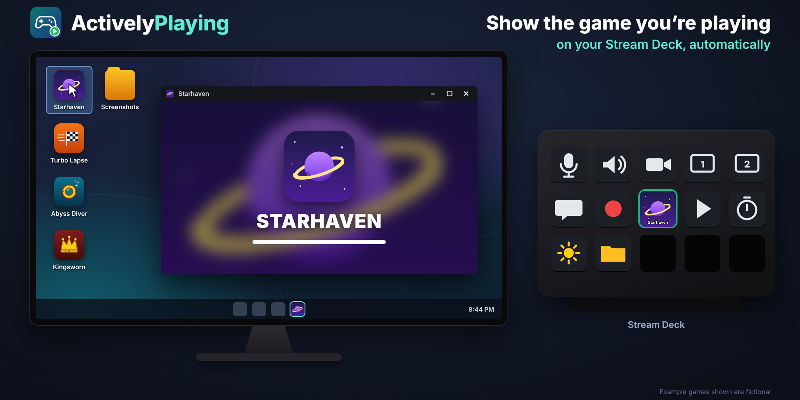
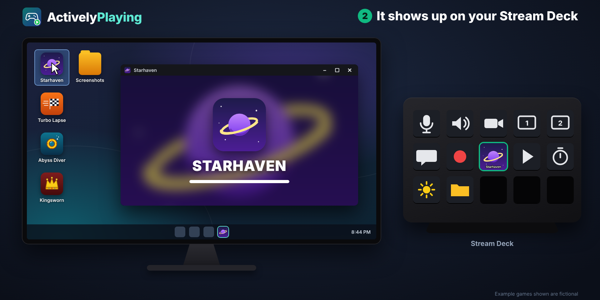
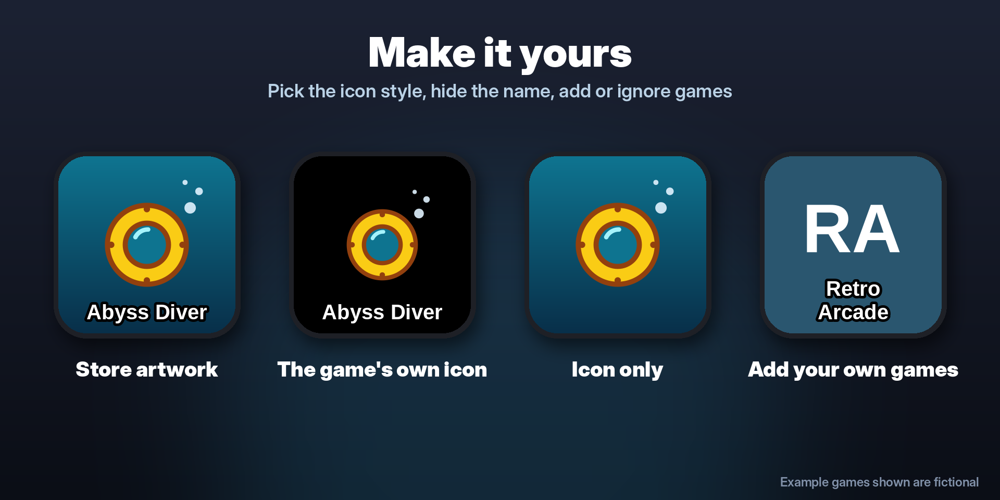

# ActivelyPlaying for Stream Deck

Puts the game you're playing on a Stream Deck key. Launch a game and the key shows its icon and name within seconds; switch games and it follows; quit and it goes back to idle.

## Where it works

- **Keys** on any Stream Deck: the game's icon, with its name as the title.
- **Stream Deck + dials**: the touchscreen above the dial shows the icon, name and "Now playing". Press the dial to check again straight away.
- **Stream Deck Neo infobar** (Stream Deck 7.6+): the same, in the strip under the keys.

## How it works

Every 5 seconds the plugin lists running processes (through PowerShell) and matches them against the public list of games Discord recognizes for its "Playing" status. The list is downloaded once a day and cached in `%LOCALAPPDATA%\streamdeck-now-playing`. Discord itself doesn't need to be installed or running.

- Programs the list marks as launchers are skipped.
- If several games are running, the most recently launched one wins.
- The icon comes from Discord's CDN, or from the game's own `.exe`. Games without an icon show their initials on a coloured key.

## Settings (per key)

- **Icon**: store artwork or the game's own icon; each falls back to the other.
- **Hide game name**: shows the icon only.
- **Extra games**: one per line, `game.exe=Game Name`.
- **Ignore**: one executable per line.

*Games shown in these images are fictional examples.*

## Known limitations

- Windows only (process scanning uses PowerShell).
- Only games in Discord's list are detected automatically; use Extra games for others.
- Games running as administrator don't expose their path, so their own icon can't be read.
- The game list comes from an undocumented Discord endpoint. If it changes, the plugin keeps working from its cached copy.

## Requirements

Windows 10 or later and Stream Deck 7.6 or later.

## Get help

- [Report a bug](https://github.com/FadingToJosh/streamdeck-plugins/issues/new?template=bug_report.yml) and pick **ActivelyPlaying** in the form.
- [Ask a question or suggest something](https://github.com/FadingToJosh/streamdeck-plugins/issues/new?template=feature_request.yml).
- [Privacy policy](PRIVACY.md)
