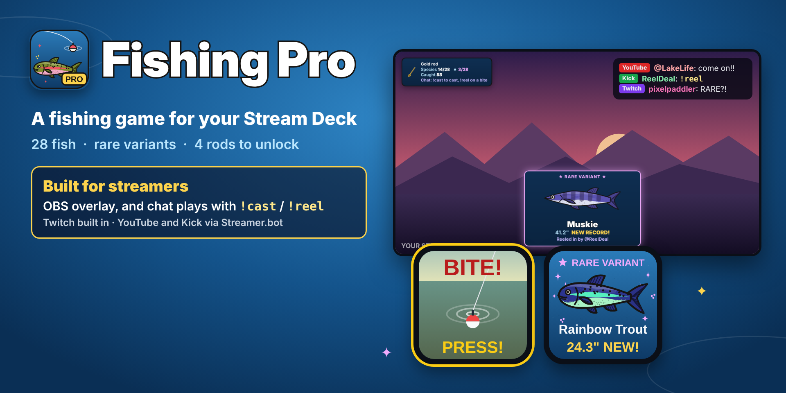
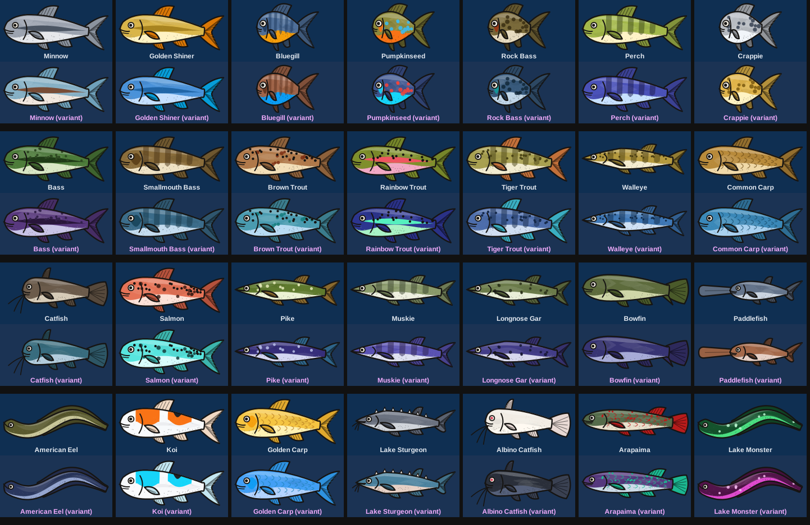
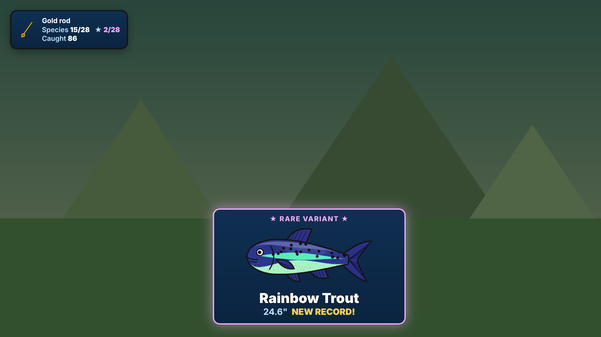
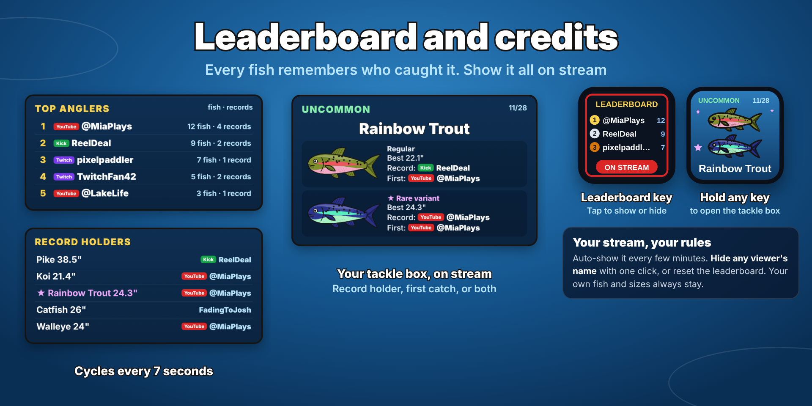

# Fishing Pro for Stream Deck

The full version of [Fishing](../fishing/README.md): 28 fish, a rare variant of every fish, four fishing rods to unlock, a Stats key and an OBS overlay.

## What's new over Fishing

- **28 fish**: adds Golden Shiner, Rock Bass, Smallmouth Bass, Tiger Trout, Bowfin, Paddlefish and Arapaima.
- **Rare variants**: every fish has a recoloured variant, 1 in 25 catches on the Basic rod.
- **Rods**: Basic → Carbon Fiber → Gold → Diamond. A new rod unlocks every 7 different species, and each one raises the odds of rare and legendary fish and of variants.
- **Tackle box**: shows both versions of each fish; each stays a silhouette until you catch it.
- **Fishing Stats key**: tap through collection, rod progress, totals and your biggest catch.
- **OBS overlay**: a stats corner, a live bobber while you fish, and catch pop-ups.
- **Chat control**: Twitch, YouTube and Kick viewers can `!cast` and `!reel`, and get credit for their catches.
- **Stream delay**: the `!reel` window lines up with what viewers actually see.
- **Leaderboard and credits**: every fish remembers its record holder and first catcher; a Leaderboard key puts the top chat anglers on stream, and the tackle box can show on stream while you browse it.

| Rod | Unlocks at | Rare + legendary catches | Variant chance |
|---|---|---|---|
| Basic | start | ~8% | 1 in 25 |
| Carbon Fiber | 7 species | ~11% | 1 in 21 |
| Gold | 14 species | ~13% | 1 in 18 |
| Diamond | 21 species | ~17% | 1 in 15 |

## OBS overlay

Open any Fishing Pro key's settings, click **Copy link**, then in OBS add a **Browser** source with that link at **1920 × 1080**. The page is transparent.

To place the pieces separately, add one browser source per piece with `?only=stats`, `?only=line`, `?only=catch` or `?only=board` (the leaderboard / tackle box panel) on the end of the link.

How it works and what keeps it private:

- The plugin runs a small web server on `127.0.0.1` (port 39217, or the next free port), so only this PC can reach it.
- Every URL includes a random private token; anything without it gets a 404. **New link** in settings replaces the token and disconnects the old link.
- Requests must use a `127.0.0.1`/`localhost` Host header, which blocks DNS-rebinding attacks.
- Live updates use Server-Sent Events.

## Chat control

All of this lives under **Streamer settings** in any Fishing Pro key's settings.

- `!cast`: anyone; only when the line is out of the water, and 30 seconds after the last result.
- `!reel`: during a bite, the first one lands the fish and the overlay shows "Reeled in by @viewer". Reels before the bite are ignored, so chat can't scare fish off.
- Chat plays whichever fishing key you pressed last (the two-key game until then). Chat catches count toward your collection.

### Twitch

Enter your channel name and tick **Let Twitch chat fish**. It connects read-only with Twitch's anonymous guest login, so there's no Twitch account, token or password to store, and it never posts in chat.

### YouTube and Kick (via Streamer.bot)

Fishing Pro reads YouTube and Kick chat through [Streamer.bot](https://streamer.bot)'s local WebSocket server, so Streamer.bot handles the platform logins and Fishing Pro never touches a Google or Kick account.

1. In Streamer.bot, connect YouTube and/or Kick under **Platforms**.
2. **Servers/Clients → WebSocket Server**: tick **Auto Start** and start it (default `127.0.0.1:8080`).
3. Tick **Read chat from Streamer.bot** in Fishing Pro. Enter a password only if you turned on WebSocket authentication; it's stored in the plugin's Stream Deck settings on this PC.

It subscribes to `YouTube.Message`, `Kick.ChatMessage` and `Twitch.ChatMessage`. While the built-in Twitch connection is up, Twitch messages from Streamer.bot are ignored so nothing counts twice.

Why not the YouTube API directly? Every streamer would need their own Google Cloud API key, and live chat reads cost quota from a 10,000-unit daily default ([quota costs](https://developers.google.com/youtube/v3/determine_quota_cost)).

### Stream delay

Viewers see the bite several seconds late. While any chat is connected:

1. **BITE!** shows for the **reel window** (default 5 s, 2–10 s).
2. The fish then stays on the line for the **stream delay** (default 5 s, 0–60 s), shown as "chat's turn…" on your keys. Your own key presses do nothing during this part.
3. A `!reel` anywhere in those two stages lands the fish; otherwise it escapes.

So viewers get the whole reel window, counted from when they see the bite. Measure your delay by watching your own stream on another device and timing the gap between **BITE!** on your key and on stream. Round up: too high only gives chat extra time. Without chat connected, bites last 1.5 s as before.

Viewer names are only ever displayed as text.

## Stream Deck Neo infobar

Drag **Fishing Status** onto the Neo's infobar (Stream Deck 7.6 or later). It follows the game live: your rod and collection while the water's calm, the bobber while you wait, a flashing **BITE!** with the chat command when something bites, then the fish you landed with its size, or a new rod. The infobar can't be pressed, so use your fishing keys to play.

## Languages

English, Spanish, Russian, German, Portuguese and French: keys, the OBS overlay, the settings panel, Stream Deck's action names (where Stream Deck supports the language) and the chat commands. **Language** defaults to **Same as Stream Deck**; Stream Deck has no Russian or Portuguese, so those are picked in the dropdown.

| Language | Cast | Reel |
|---|---|---|
| English | `!cast` | `!reel` |
| Spanish | `!lanzar` | `!sacar` |
| Russian | `!заброс` | `!тяни` |
| German | `!werfen` | `!ziehen` |
| Portuguese | `!lançar` | `!puxar` |
| French | `!lancer` | `!ferrer` |

- **Chat commands** can be replaced with your own under Streamer settings. English `!cast` and `!reel` always work too, and capitals and accents don't matter (`!LANCAR` works).
- **Sizes** show in centimetres in every language but English. Saved sizes are still inches, so switching languages changes nothing in your records.
- Fish names for North American species are best-effort translations. Corrections are welcome as issues.

## Leaderboard and credits

Every catch is credited: the **record holder** (biggest) and the **first catcher** of each fish and of each rare variant. Your own key catches are credited to the name you set under **Your name** (default "Streamer"). Catches from before 1.3 have no names.

- **Tackle box on stream**: while the tackle box is open on any key, the overlay's top-right panel shows the same page, large, with the credits. Turn it off with **Show it on stream while it's open on a key**.
- **Show on fish**: record holder, first catch, or both.
- **Leaderboard key**: tap to put the leaderboard on stream, tap again to take it off. It cycles between **Top anglers** (most fish, then records held) and **Record holders** (rarest fish first). You aren't on the leaderboard; only chat is.
- **Auto-show**: show the leaderboard every N seconds for M seconds (0 = off). It waits until your line is out of the water.
- **Hide name**: pick a viewer and hide them. Their catches still count, but their name never shows on stream again (the tackle box says "hidden", catch pop-ups drop the credit line) and they leave the leaderboard. Select them again to undo.
- **Reset leaderboard**: clears every viewer's name and tally. Your fish, sizes and your own credits stay.

Viewers are counted per platform (`ReelDeal` on Kick and on Twitch are two entries). The leaderboard keeps the top 50 viewers plus anyone holding a record or first catch, so saved settings stay small.

## Requirements

Windows 10 or later and Stream Deck 7.6 or later. The Fishing Status action needs a Stream Deck Neo.

## Get help

- [Report a bug](https://github.com/FadingToJosh/streamdeck-plugins/issues/new?template=bug_report.yml) and pick **Fishing Pro** in the form.
- [Ask a question or suggest something](https://github.com/FadingToJosh/streamdeck-plugins/issues/new?template=feature_request.yml).
- [Privacy policy](PRIVACY.md)
