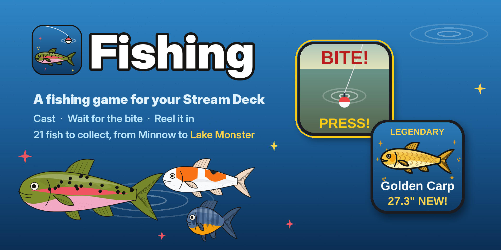
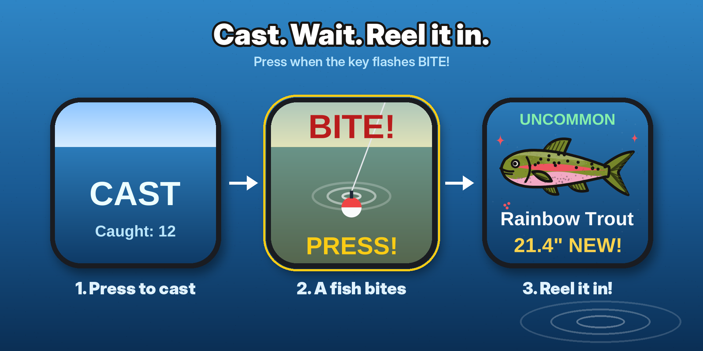
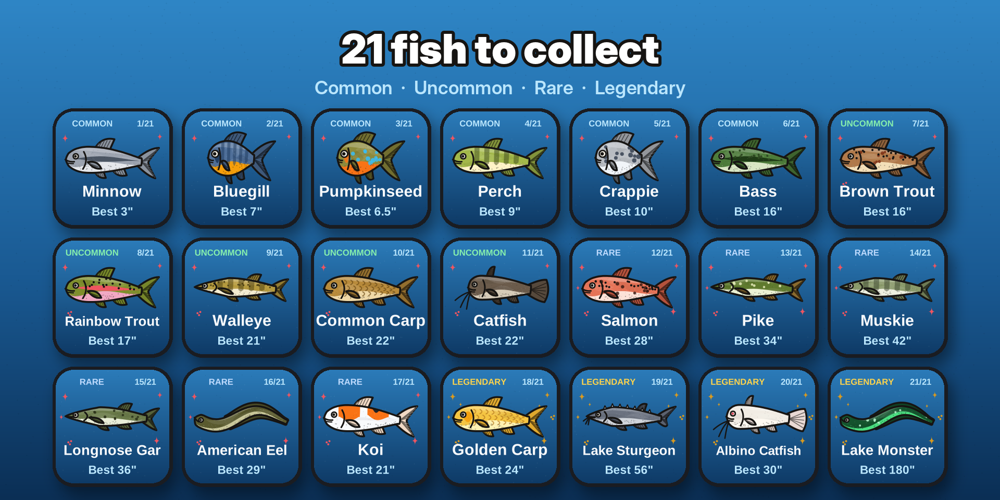

# Fishing for Stream Deck

Want more fish, rods and stream features? See [Fishing Pro](../fishing-pro/README.md).

A fishing game played on your Stream Deck keys. Cast your line, watch for a bite, and press at the right moment to reel in one of 21 illustrated fish.

## Actions

| Action | What it does |
|---|---|
| **Fishing Spot** | The water. Shows the bobber and flashes **BITE!** Pair it with a Fishing Rod key. |
| **Fishing Rod** | Casts and reels in for two-key play. |
| **Fishing** | The whole game on a single key. |

Hold any fishing key to open the **tackle box**: your collection, total catches and best size for each fish. Tap to flip pages, hold again to close.

## How to play

1. Press to cast.
2. Wait 3–12 seconds for a bite.
3. When the key flashes **BITE!**, press within 1.5 seconds to land the fish. Press too early and you reel in nothing; too late and it gets away.

There are 21 fish across common, uncommon, rare and legendary tiers, plus the occasional old boot. Catches and personal bests are saved between sessions.

## Requirements

Windows 10 or later and Stream Deck 7.1 or later. Works on any Stream Deck with keys.

## Get help

- [Report a bug](https://github.com/FadingToJosh/streamdeck-plugins/issues/new?template=bug_report.yml) and pick **Fishing** in the form.
- [Ask a question or suggest something](https://github.com/FadingToJosh/streamdeck-plugins/issues/new?template=feature_request.yml).
- [Privacy policy](PRIVACY.md)
